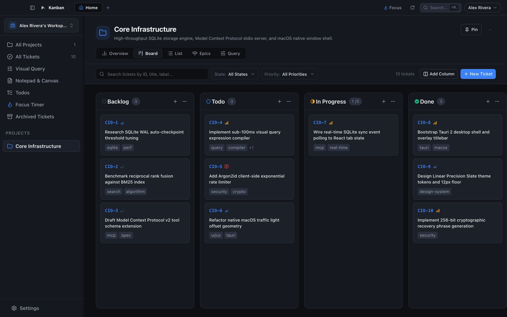
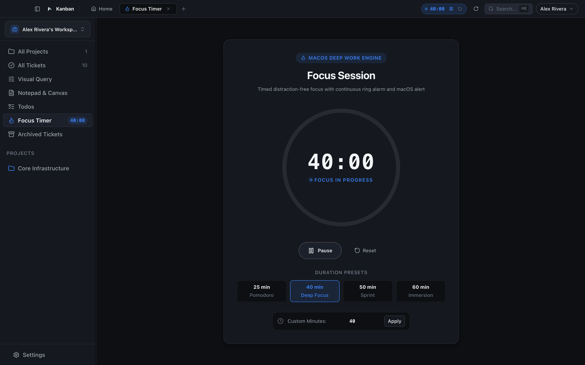
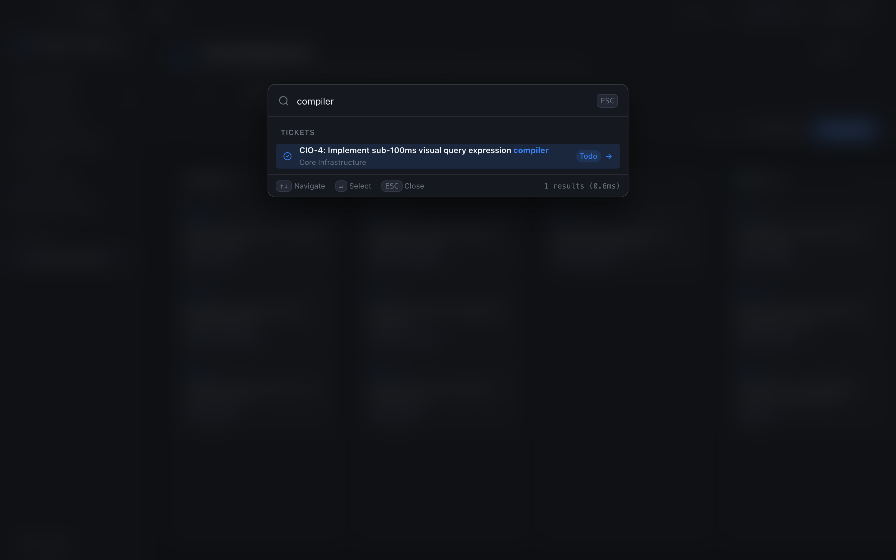
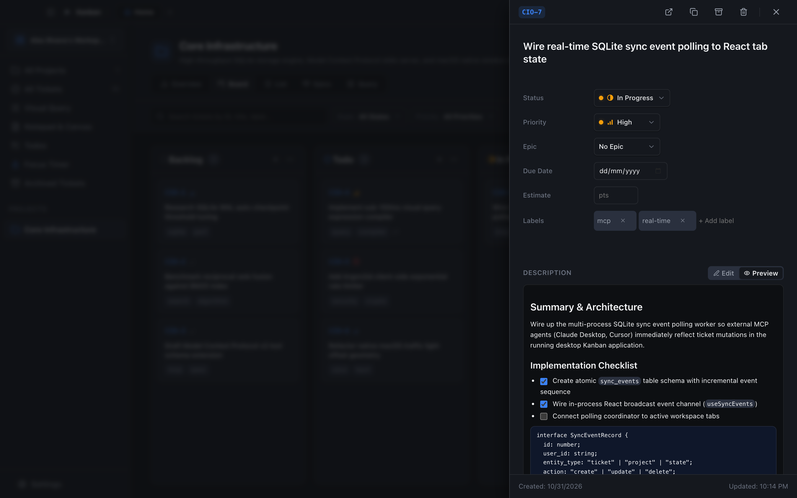
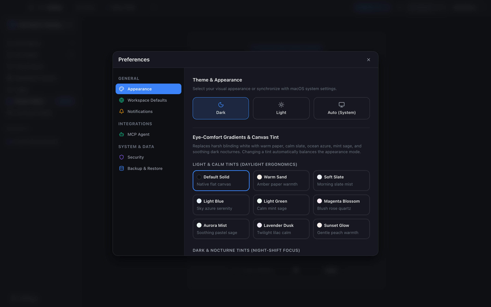

# Kanban

> **Offline-first, native macOS personal project management & customizable Kanban workspace with first-class Model Context Protocol (MCP) agent integration.**

[](https://github.com/devvvvvX/kanban/releases)
[](https://apple.com)
[](https://tauri.app)
[](https://react.dev)
[](https://www.typescriptlang.org)
[](https://sqlite.org)
[](docs/MCP_GUIDE.md)
[](#privacy--data-sovereignty)
[](scripts/run-tests.sh)
[](LICENSE)

---

## What is Kanban?

**Kanban is a private, lightweight engineering workspace built natively for macOS.**

Most modern project management tools have evolved into heavy cloud web applications burdened by mandatory subscription lock-in, sluggish multi-second page transitions, tracking telemetry, and opaque cloud databases.

Kanban was built with a different philosophy:
- **Zero Cloud Lock-in**: All tickets, epics, notes, and projects reside locally on your Mac in SQLite (Write-Ahead Logging).
- **Sub-100ms Performance**: Instant card dragging, live visual query compilation across 5,000+ tickets, and keyboard-first navigation (<kbd>Cmd</kbd> + <kbd>K</kbd>, <kbd>Cmd</kbd> + <kbd>N</kbd>, <kbd>Cmd</kbd> + <kbd>\</kbd>).
- **First-Class AI Agent Co-Working**: Native **Model Context Protocol (MCP)** stdio server allows Claude Desktop, Cursor, and autonomous coding agents to inspect your backlog, plan sprints, and update tickets in real time.
- **Deep Relational Tracking**: Full `Account → Workspace → Project → Epic → Ticket → Subtasks & Dependencies` relational hierarchy.

```text
┌────────────────────────────────────────────────────────────────────────────────────────┐
│  Kanban ─ Personal Workspace                              [ 40:00 ⏱️ ]   [ ⌘K Search ] │
├───────────────────┬────────────────────────────────────────────────────────────────────┤
│ 📁 Projects       │  🚀 Project: Core Infrastructure (INFRA)                           │
│   • Infrastructure│ ┌───────────────┐ ┌───────────────┐ ┌───────────────┐ ┌──────────┐ │
│   • Mobile App    │ │ BACKLOG (3)   │ │ TODO (2)      │ │ IN PROGRESS(1)│ │ DONE (8) │ │
│   • Interview Prep│ ├───────────────┤ ├───────────────┤ ├───────────────┤ ├──────────┤ │
│ 🎯 Epics          │ │ INFRA-10      │ │ INFRA-42      │ │ INFRA-38      │ │ INFRA-1  │ │
│ ⏱️ Focus Timer    │ │ Database WAL  │ │ Optimize query│ │ Wire MCP Stdio│ │ Init App │ │
│ 📝 Scratchpad     │ │   ● Urgent    │ │   ● High      │ │   ● High      │ │   ● Low  │ │
│ ✅ Daily Todos    │ │   [2/2 sub]   │ │   [0/3 sub]   │ │   [1/2 sub]   │ │   [Done] │ │
│ 📦 Archived       │ └───────────────┘ └───────────────┘ └───────────────┘ └──────────┘ │
└───────────────────┴────────────────────────────────────────────────────────────────────┘
```

---

## 📸 Visual Showcase

<div align="center">
  
  <p><em>Kanban Board view with custom status columns, WIP limits, priority pips, and subtask progress rollups.</em></p>
</div>

<br />

<table align="center" width="100%">
  <tr>
    <td width="50%" align="center">
      
      <br /><strong>Focus Session & Deep Work Timer</strong>
    </td>
    <td width="50%" align="center">
      
      <br /><strong>Spotlight Command Palette (<kbd>Cmd+K</kbd>)</strong>
    </td>
  </tr>
  <tr>
    <td width="50%" align="center">
      
      <br /><strong>Ticket Drawer with Markdown by Default</strong>
    </td>
    <td width="50%" align="center">
      
      <br /><strong>Sonoma Preferences & Eye-Comfort Gradients</strong>
    </td>
  </tr>
</table>

---

## ⚡ Key Capabilities

### 1. Customizable Kanban Board & Relational Tickets
- **Human-Readable Prefixed IDs**: Tickets automatically inherit their project code (e.g. `APP-101`, `INFRA-42`).
- **Configurable Workflow Columns**: Create, rename, recolor, and reorder custom columns (Backlog, Todo, In Progress, Review, Done) with category bindings.
- **WIP Limits & Guardrails**: Set Work-In-Progress limits per column with real-time visual warning tags and safe column deletion with ticket reassignment.
- **Relational Work Hierarchy**: `Projects` $\rightarrow$ `Epics` $\rightarrow$ `Tickets` $\rightarrow$ `Subtasks & Dependencies`.
- **Markdown Slide Drawer**: Inspect and edit descriptions in Markdown by default with interactive checkboxes, syntax highlighting, and discussion threads.

### 2. Focus Session & Deep Work Timer
- **Live Header Countdown Pill**: Displays active countdown in the native macOS header without cluttering the canvas.
- **Deep Work Presets**: Quick launch 25 min (Pomodoro), 40 min, 50 min, or custom durations.
- **Audio Synthesis & Gentle Alerts**: Customizable tones (`ping`, `bell`, `chime`, `pop`, `subtle`) with native macOS system alert banners.

### 3. Sub-100ms Visual Query Engine & Saved Views
- **Visual Expression Builder**: Query tickets by status, priority, epic, due date, or labels with explicit `AND`/`OR` clause composition.
- **Parameterized SQL Generation**: Compiles visual query ASTs directly to parameterized SQLite queries in sub-100ms.
- **Saved Queries**: Save frequently used queries to the project sidebar for instant 1-click execution.

### 4. First-Class Model Context Protocol (MCP) Agent Integration
- **Official Specification**: Conforms to MCP 2024-11-05 standard over stdio (`JSON-RPC 2.0`).
- **Supported AI Assistants**: Works out of the box with **Claude Desktop**, **Cursor IDE**, **Antigravity**, and autonomous agent runners.
- **8 Core Domain Tools**: `list_tickets`, `get_ticket`, `create_ticket`, `update_ticket`, `delete_ticket`, `search_tickets`, `list_projects`, and `get_project_summary`.
- **Real-Time UI Reflection**: Database changes executed by external MCP agents reflect in the desktop application within 1 second.
- **Read the [MCP Integration Guide](docs/MCP_GUIDE.md)** for complete configuration examples.

### 5. Eye-Comfort Canvas Gradients & Automatic Appearance Balancing
- **Eye-Comfort Tints**: Mitigate monitor glare during long coding sessions with customizable tints:
  - *Fresh & Light*: `warm-sand`, `soft-slate`, `light-blue`, `light-green`, `magenta`, `aurora-mist`, `lavender-dusk`, `sunset-glow`.
  - *Dark Nocturnes*: `dark-obsidian`, `navy-blue`, `dark-emerald`, `dark-magenta`, `deep-indigo`.
- **Automatic Balancing**: Selecting any light tint automatically sets `data-theme="light"` and high-contrast dark text/borders. Selecting any dark nocturne sets `data-theme="dark"` with crisp luminous text.

### 6. Privacy & Data Sovereignty
- **100% Offline-First**: Zero tracking, zero telemetry, zero background network calls.
- **Multi-Account Isolation**: Multiple local user accounts on one machine with strict cryptographic separation.
- **Argon2id Password Security**: Secure hashing (`m=65536, t=3, p=4`) with client-side exponential rate limiting.
- **256-Bit Recovery Keys**: Offline high-entropy cryptographic recovery keys for password reset without cloud dependencies.
- **Portable Backups**: Full JSON database backup and restore with SHA-256 checksum verification and Merge/Replace modes.

### 7. Multi-Tab Navigation & Persistent Webviews
- **Workspace Tab System**: Switch smoothly between Board, Dedicated Ticket Detail pages, Focus Timer, Epics, Daily Todos, Notes, and Archived Tickets.
- **Persistent DOM / Iframe State**: Open `<WebviewTab>` instances remain mounted in the DOM across tab switches (`display: none` when inactive). YouTube videos, audio playback, documentation forms, and scroll positions persist seamlessly without resetting or reloading.

### 8. Keyboard-First Efficiency
- <kbd>Cmd</kbd> + <kbd>K</kbd>: Global Spotlight search and command palette.
- <kbd>Cmd</kbd> + <kbd>N</kbd>: Quick ticket creation.
- <kbd>Cmd</kbd> + <kbd>\</kbd>: Toggle sidebar collapse.
- <kbd>Esc</kbd>: Predictable LIFO modal/drawer dismiss stack.

---

## 🏗️ Architecture & Technology Stack

```text
kanban/
├── src/                    # Frontend UI (React 19 + TypeScript + Vite)
│   ├── components/         # Board, tickets, drawers, modals, sidebar, search
│   ├── context/            # Scoped React Contexts (Auth, Project, Ticket, Tab, Focus)
│   ├── lib/                # SQLite WAL storage, Query Compiler, MCP server, Auth crypto
│   ├── styles/             # Vanilla CSS design system (theme.css tokens)
│   └── types/              # Strict TypeScript domain interfaces
├── src-tauri/              # Native macOS Desktop Shell (Tauri 2 + Rust)
│   ├── src/                # IPC endpoints: native notifications, finder reveal, window focus
│   ├── Cargo.toml          # Rust dependencies & metadata
│   └── tauri.conf.json     # Overlay titlebar & traffic light geometry
├── scripts/                # Utility scripts: build-dmg.sh, kanban-mcp, update-local-app.sh
├── docs/                   # Architecture specs, design system invariants & MCP guide
└── tests/                  # 39 test suites (208 passing unit, integration & benchmark tests)
```

| Layer | Technology | Details |
|---|---|---|
| **Desktop Shell** | **Tauri 2 (Rust)** | Native macOS bundle (`<60MB RAM`), overlay titlebar, system appearance sync. |
| **Frontend UI** | **React 19 + TypeScript** | Strict type-safety, zero heavy component frameworks, sub-100ms reactivity. |
| **Styling** | **Vanilla CSS Tokens** | Custom HSL tokens in `theme.css`, 12px font floor rule, glassmorphism. |
| **Database** | **SQLite (WAL mode)** | `better-sqlite3` & `rusqlite` on desktop, `sql.js` WASM + IndexedDB in browser. |
| **AI Protocol** | **Model Context Protocol (MCP)** | JSON-RPC 2.0 stdio server exposing 8 tools with token authorization. |
| **Testing** | **Vitest** | 39 test suites with 208 automated unit, integration, and benchmark tests. |

---

## 🚀 Quick Start

### Option A: Install Distributable DMG (macOS)
1. Download the latest `.dmg` installer from [Releases](https://github.com/devvvvvX/kanban/releases).
2. Open the disk image and drag **Kanban** into your `/Applications` folder.
3. Launch Kanban.

### Option B: Build from Source

#### Prerequisites
- **macOS**: 13.0+ (Apple Silicon or Intel)
- **Xcode Command Line Tools**:
  ```bash
  xcode-select --install
  ```
- **Node.js**: 20+ (v22 recommended) & `npm`
- **Rust & Cargo** (required by Tauri 2 to compile the native macOS application wrapper & DMG):
  ```bash
  # Option 1: Official rustup installer (recommended)
  curl --proto '=https' --tlsv1.2 -sSf https://sh.rustup.rs | sh -s -- -y
  source "$HOME/.cargo/env"

  # Option 2: Homebrew
  brew install rust
  ```
  *Verify that Cargo and rustc are in your `$PATH`:*
  ```bash
  cargo --version
  rustc --version
  ```

> [!TIP]
> If you encounter `Error: Cargo (Rust) is not installed or not in PATH.` when running `./scripts/build-dmg.sh` or `npm run build:dmg`, ensure Rust is installed and Cargo's environment is sourced into your current shell via `source "$HOME/.cargo/env"`.

```bash
# 1. Clone the repository
git clone https://github.com/devvvvvX/kanban.git
cd kanban

# 2. Install dependencies
npm install

# 3. Run in browser development mode
npm run dev

# 4. Or run inside the native macOS desktop shell
npm run tauri dev
```

### Building Release Packages

```bash
# Compile frontend and standalone MCP server bundle
npm run build

# Hot-deploy in-place to /Applications/Kanban.app (preserves SQLite database & tokens)
./scripts/update-local-app.sh

# Package a signed/unsigned release DMG installer
npm run build:dmg
```

---

## 🤖 Model Context Protocol (MCP) Setup

Connect Claude Desktop or Cursor to Kanban in seconds:

### Claude Desktop (`claude_desktop_config.json`)

```json
{
  "mcpServers": {
    "macos-kanban": {
      "command": "/Applications/Kanban.app/Contents/MacOS/kanban-mcp",
      "args": [],
      "env": {
        "KANBAN_AUTH_TOKEN": "<your-token-from-settings>"
      }
    }
  }
}
```

*Get your auth token in Kanban: `Preferences > MCP Agent > Copy Token`.*  
See the full [MCP Guide](docs/MCP_GUIDE.md) for detailed tool schemas and Cursor configuration.

---

## ⌨️ Keyboard Shortcuts Reference

| Shortcut | Action |
|---|---|
| <kbd>⌘</kbd> + <kbd>K</kbd> | Open global command palette & search |
| <kbd>⌘</kbd> + <kbd>N</kbd> | Open new ticket creation tab |
| <kbd>⌘</kbd> + <kbd>\</kbd> | Toggle left sidebar visibility |
| <kbd>⌘</kbd> + <kbd>R</kbd> | Refresh workspace data |
| <kbd>Esc</kbd> | Dismiss active modal, slide drawer, or popover (LIFO order) |
| <kbd>Enter</kbd> | Save and confirm current modal or inline input |

---

## 🧪 Automated Testing

Kanban enforces rigorous test suites covering authentication cryptography, relational ticket hierarchies, visual query compilation, MCP stdio communication, and UI design token assertions:

```bash
# Run all 39 test suites (208 tests)
npm test

# Run tests in watch mode
npm run test:watch

# Run TypeScript typechecker
npm run typecheck
```

---

## 🤝 Contributing

Contributions, bug reports, and feature suggestions are warmly welcomed! Please read our [CONTRIBUTING.md](CONTRIBUTING.md) and [CODE_OF_CONDUCT.md](CODE_OF_CONDUCT.md) before submitting pull requests.

---

## 📄 License

Kanban is open-source software licensed under the [MIT License](LICENSE).  
Copyright (c) 2026 [devvvvvX](https://github.com/devvvvvX).
