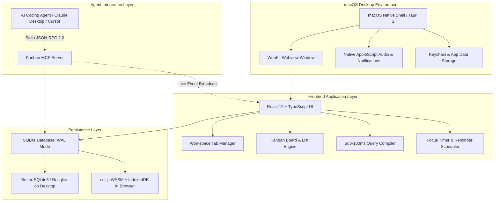

# Kanban Architecture & Technical Specification

> **Deep-dive architectural documentation for developers, contributors, and systems engineers.**

---

## 1. High-Level System Architecture

Kanban is engineered as a lightweight, offline-first personal engineering workstation for macOS. It combines the speed and security of a compiled desktop shell with the flexibility of a modern React interface and relational SQLite storage.



---

## 2. Core Relational Data Model

Kanban rejects fragile key-value and flat JSON stores in favor of strict, foreign-key enforced relational schemas:

```text
Account (User)
  └── Workspace
        ├── Project (Custom Hex Colors, Icon, Prefix APP-)
        │     ├── Epics (Roadmap milestones, progress bars)
        │     └── Workflow States (Backlog, Todo, In Progress, Done, Custom WIP)
        │           └── Tickets (Title, Markdown Body, Priority, Due Date)
        │                 ├── Subtasks (Checklist with completion rollup)
        │                 ├── Dependencies (Blocks / Blocked By graph)
        │                 ├── Comments (Discussion thread & links)
        │                 └── Activity Logs (Audit trail of modifications)
        ├── Daily & Cadence Todos (Recurring checklist with Remind Me alerts)
        └── Notepad / Canvas (Draft notes, Whiteboard canvas, scratchpad)
```

### Relational Schema Invariants

1. **Deterministic Prefixed IDs**: Tickets automatically inherit their project's identifier prefix (e.g. `APP-1`, `INFRA-42`). A dedicated atomic counter table guarantees sequence continuity without race conditions.
2. **Cascading Safety**: Deleting a workflow state gracefully prompts ticket migration to prevent orphaned tickets. Deleting a project archives or purges child entities transactionally.
3. **Multi-Column Performance Indexes**:
   - `idx_tickets_project_status`: Accelerates board column queries.
   - `idx_tickets_project_priority`: Accelerates sorted list views.
   - `idx_tickets_search`: Covers title and ticket identifier for instant sub-50ms search lookups.

---

## 3. Sub-100ms Visual Query Engine

Kanban includes a specialized visual query compiler capable of evaluating complex multi-criteria expressions across 5,000+ tickets in under 100ms.

### Query Compilation Pipeline


1. **Clause Composition**: Supports combining criteria with explicit boolean operators:
   - `AND` clauses (e.g., `status = 'in_progress' AND priority = 'urgent'`)
   - `OR` clauses (e.g., `assignee = 'me' OR due_date < NOW()`)
2. **Zero SQL Injection Risk**: All criteria values are strictly parameterized using SQLite positional bindings (`?`).
3. **Saved Query Views**: Persisted query definitions allow 1-click execution from the project sidebar.

---

## 4. Multi-Account Isolation & Cryptographic Model

Kanban is built for software engineers who switch between personal projects, consulting work, and open-source development without data bleed.

### Authentication & Password Hashing
- **Algorithm**: Argon2id (`m=65536, t=3, p=4`) via native `@node-rs/argon2` or compiled WebAssembly fallback (`hash-wasm`).
- **Cryptographic Salt**: 128-bit cryptographically secure random per-user salt.
- **Client-Side Rate Limiter**: Exponential backoff locks the interface after 5 consecutive failed authentication attempts.

### Offline Cryptographic Recovery Keys
- Upon account creation, users receive a 256-bit high-entropy recovery phrase (e.g. `brave-crimson-hawk-8492-delta-quartz`).
- Hashed using SHA-256 and stored alongside the user record.
- Allows immediate, 100% offline password reset without reliance on external email servers or third-party auth providers.

---

## 5. Model Context Protocol (MCP) Stdio Architecture

Kanban exposes a production-ready stdio server conforming to the official Model Context Protocol (MCP) 2024-11-05 specification.

### Stdio Transport Protocol
- Communicates over standard input/output (`stdin` / `stdout`) using JSON-RPC 2.0 messages.
- Diagnostic logs and error traces are routed strictly to `stderr` to avoid corrupting protocol frames.

### Available Domain Tools

| Tool Name | Parameters | Description |
|---|---|---|
| `list_projects` | `{}` | Lists all active and pinned projects for the authenticated account. |
| `get_project_summary` | `projectId` | Returns total ticket counts, breakdown by column, and completion %. |
| `list_tickets` | `projectId, status, priority, limit` | Lists tickets matching specified criteria. |
| `get_ticket` | `ticketId` | Retrieves complete ticket details including subtasks and dependencies. |
| `create_ticket` | `projectId, title, description, priority, status` | Creates a new relational ticket with auto-incrementing ID. |
| `update_ticket` | `ticketId, fields` | Modifies ticket attributes (status, title, priority, due date). |
| `delete_ticket` | `ticketId` | Safely removes a ticket and its associated subtasks. |
| `search_tickets` | `query, projectId` | Performs full-text keyword search across titles and descriptions. |

### Real-Time Desktop UI Reflection
- When an MCP agent creates or updates a ticket, an SQLite sync event is recorded in `sync_events`.
- The desktop app's polling coordinator detects database changes and broadcasts state updates to the UI, reflecting agent changes in real time without manual reload.

---

## 6. Native macOS Desktop Integration

- **Window Titlebar Overlay**: Configured with `titleBarStyle: "Overlay"` in `tauri.conf.json`. Window drag handles avoid traffic light collision with a calibrated inset `{ x: 16, y: 22 }`.
- **System Sound & Audio**: Web Audio API oscillator synthesis (`ping`, `bell`, `chime`, `pop`, `subtle`) paired with continuous ringing for urgent reminders.
- **Native Notifications**: Dispatched via macOS AppleScript (`osascript`) with critical user attention window bouncing (`request_user_attention`).
- **File System Persistence**: Release databases are stored in `~/Library/Application Support/com.kanban.macos/kanban.db` following Apple sandboxing conventions.

